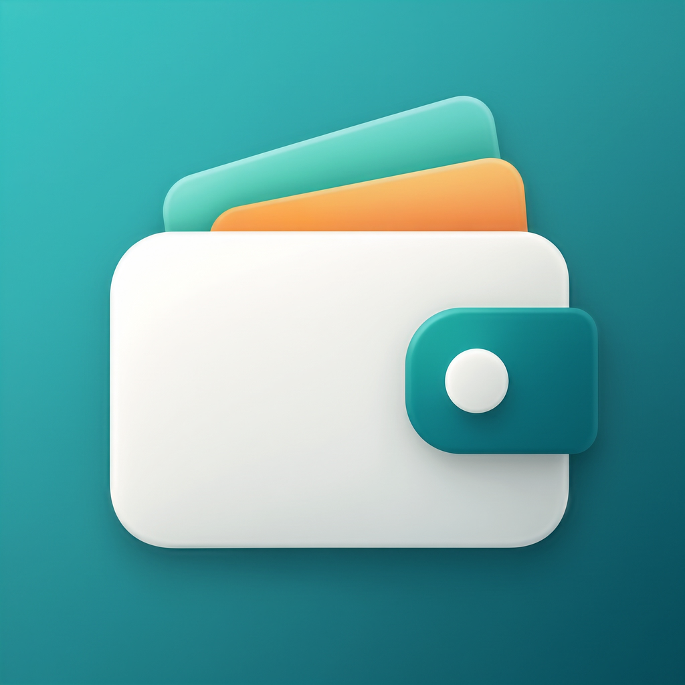

<div align="center">



# Timonia — Releases

**Sorgente di distribuzione di Timonia per iPhone, tramite SideStore.**

Finanze personali e condivise, offline-first.

[](https://github.com/Marchisceddu/timonia-releases/releases/latest)


</div>

---

Questo repository **non contiene il codice di Timonia**: contiene solo ciò che serve a installare e aggiornare l'app sul tuo iPhone, cioè la sorgente SideStore (`source.json`), l'icona e i file `.ipa` allegati alle [Release](https://github.com/Marchisceddu/timonia-releases/releases).

## Indice

- [Cos'è Timonia](#cosè-timonia)
- [Installazione](#installazione)
- [Aggiornare l'app](#aggiornare-lapp)
- [Rinnovo ogni 7 giorni](#rinnovo-ogni-7-giorni)
- [Problemi comuni](#problemi-comuni)
- [Contenuto del repository](#contenuto-del-repository)
- [Sicurezza e privacy](#sicurezza-e-privacy)
- [Licenza](#licenza)
- [Contatti](#contatti)

## Cos'è Timonia

Timonia è un'app per gestire le **finanze personali** e le **spese condivise** con amici e coppie: movimenti, gruppi, saldi, budget e report. Funziona anche **offline** e sincronizza i dati quando torna la connessione.

## Installazione

### Cosa serve

| Requisito | Dettaglio |
| --- | --- |
| iPhone | iOS **16.0** o successivo |
| [SideStore](https://sidestore.io/) | Installato e configurato ([guida ufficiale](https://docs.sidestore.io/docs/installation/prerequisites)) |
| Apple ID | Anche gratuito |
| Email | Per usare l'app ti registri con la tua email e confermi il codice che ricevi |

### Passi

1. Sull'iPhone attiva la **VPN di SideStore**.
2. Apri questo link dall'iPhone per aggiungere la sorgente a SideStore:

   **[Aggiungi la sorgente Timonia](sidestore://source?url=https://raw.githubusercontent.com/Marchisceddu/timonia-releases/main/source.json)**

   Se il link non si apre, in SideStore vai in **Sources → `+`** e incolla:

   ```text
   https://raw.githubusercontent.com/Marchisceddu/timonia-releases/main/source.json
   ```

3. Apri la sorgente, trova **Timonia** e tocca **FREE** / **INSTALL**.
4. Solo la prima volta: *Impostazioni → Generali → VPN e gestione dispositivi* → tocca il tuo Apple ID → **Autorizza**.

## Aggiornare l'app

Quando esce una nuova versione, in SideStore → **My Apps** compare il pulsante **UPDATE** accanto a Timonia. Attiva la VPN di SideStore e toccalo: **dati locali, conti e accesso restano al loro posto**.

## Rinnovo ogni 7 giorni

Con un Apple ID gratuito Apple fa scadere l'app dopo **7 giorni**. Per rinnovarla:

- **Manuale:** attiva la VPN di SideStore → **My Apps** → **Refresh All**.
- **Automatico (consigliato):** crea un'automazione in *Comandi Rapidi* che ogni notte connette la VPN, esegue **Refresh All Apps** e la disconnette.

Se l'app scade non perdi i dati: rinnovandola torna come prima.

> [!IMPORTANT]
> Un Apple ID gratuito permette al massimo **3 app attive** sullo stesso iPhone. SideStore ne occupa una.

## Problemi comuni

| Sintomo | Cosa fare |
| --- | --- |
| SideStore non accede con l'Apple ID | *Settings → User Customizations*: disattiva **On-Device Anisette**, scegli un altro **Anisette Server**, premi **Reset adi.pb**, chiudi e riapri SideStore |
| Installazione o refresh falliscono | Controlla che la **VPN di SideStore** sia attiva e di essere online |
| Il pulsante UPDATE non compare | Ricarica la sorgente in *Sources* |
| L'app si chiude subito all'apertura | È scaduta: esegui **Refresh All** |

## Sicurezza e privacy

- Il pacchetto `.ipa` viene firmato **sul tuo iPhone** con il **tuo** Apple ID: non condividi credenziali con me.
- Ogni release riporta lo **SHA-256** del file nelle note: puoi verificarlo prima di installare.
- L'app contiene solo indirizzi e identificativi pubblici; nessun segreto.
- Come Timonia tratta i tuoi dati è descritto nell'informativa privacy dell'app (*Profilo → Informativa privacy*).

## Licenza

Timonia è distribuita in forma di **solo binario** con licenza proprietaria: puoi installarla e usarla per **uso personale e non commerciale**; non puoi ridistribuirla, decompilarla o modificarla. Il testo completo è nel file [LICENSE](LICENSE).

L'app include software open source di terze parti, con le rispettive licenze, consultabile nell'app (*Profilo → Licenze*).

SideStore, AltStore, iOS e Apple sono marchi dei rispettivi proprietari; questo progetto non è affiliato ad Apple né al progetto SideStore.
